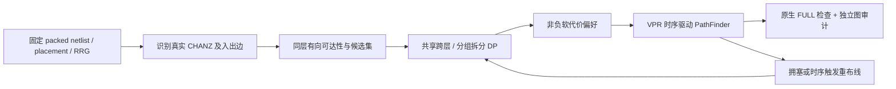

# H3D → 原生 3D FPGA 布线：实现、证据与研究判断

本报告对应用户 HTML 中的“方案 A”，记录 2026-10-22 完成的软件实现、筛查、独立审计与串行计时。量化结果由归档 manifest 和独立审计自动生成，见[实验结果](实验结果.md)。

**迁移在工程上可实现，但应迁移“跨层资源共享/拆分的树级决策”，不能直接套用 H3D 的连续几何模型或其最优性结论。** 已实现的 A1–A4 都在真实有向 RRG 上运行；详细布线和时序仍由 VPR 完成。是否值得作为性能优化方法，必须以超越调参后的简单代价和原生剪枝对照为依据。
本轮结论是：**静态 A3 存在条件性时序收益，复杂 A4 未显示稳定综合优势；两者均没有在受控计时中实现加速。** 适合继续验证 A3 的适用条件与机制，尚不适合把当前 A4 作为已证实的性能提升方案。

## 1. 对原分析需要补充的事实

[H3D 原论文](https://www.cse.cuhk.edu.hk/~byu/papers/C297-ICCAD2025-3DRoute.pdf)面向混合键合三维 IC 的布线资源，结合平面树、跨 die 连接分配和几何优化。FPGA 已经制造好的线段、可编程开关、方向和共享容量约束不同：几何上相邻的点未必有可用边，最短 Manhattan 连接也未必能实现。原文的连续可行区域性质不能直接证明离散 FPGA 图上的最优性。

当前基线也应更新。[2026 年多 die VTR 工作](https://arxiv.org/abs/2606.06421)已将原生三维资源建模与相关布局布线增强整合到 VTR master。项目固定在提交 `0b912334fdd83bb754b302146ac0d1ec9edc9a0e`，使用其 CHANZ 和 scatter/gather 模型。A0 本身就是支持三维图的时序驱动路由器，因此“增加 Z 方向”或“使用 PathFinder”均不能作为本工作的独立创新；更早的 [3DPRO](https://doi.org/10.1155/2008/764942)也已涉及三维 FPGA 布线。

[LaZagna](https://github.com/sharc-lab/LaZagna)仍适合研究旧版 3D SB/CB 架构，但其检视版本存在以成对 CHANX 节点表示一个物理跨层通道的编码。不能把图节点数直接解释为键合点数，也不能把该分支与当前 VTR 的时延/速度差直接归因于算法。当前实现只把原生 CHANZ 作为候选，审计器对旧编码要求显式物理资源映射。

[PathSteiner 论文](https://www.shashwatshrivastava.com/documents/FCCM26_PathSteiner.pdf)及[公开代码包](https://zenodo.org/records/19204522)显示，其方法包括 FLUTE、L 分解、约束区域、lookahead、释放策略及增量路由设置。实际 launcher 关闭时序分析。本项目移植 FLUTE 基元并实现静态软引导对照，没有将该对照冒称为完整 PathSteiner 复现。[Steiner 势场工作的出版方摘要](https://ieeexplore.ieee.org/abstract/document/11552685)支持势场和 sink 排序这一方向；完整公式与代码未获得，本项目明确公开自己的对照公式，不声称复现或击败原论文。详见[文献对照边界](literature_controls.md)。

## 2. 实际迁移的算法

设原生有向布线图为 `G=(V,E)`，每个节点具有类型、层、容量和原生电学参数；边携带实际开关 ID。网络 `n` 的路由为以源为根的有向树 `T_n`。普通共享线段及垂直通道的占用按使用它的网络计数，同一网络的共享树枝不能重复计费。SINK 类容量和可编程配置等特殊规则沿用 VPR。

迁移可分为三层：



**可达性层。** 对跨层 sink `i`，候选 `c` 需要同时满足“源可经同层有向边到达 c 的真实入口”和“c 的真实出口可经同层有向边到达 i”。反向索引仅用于可达性查询，不增加任何可用反向边。参考版使用 BFS；SCC 版在不含 Z 的同层图上做强连通分量压缩，再查凝聚 DAG。几何距离只用于候选排序和代理成本。

这保证候选存在单次跨层的图路径，不保证它在当前 bounding box 中可实现，也不保证与其他网络无冲突。候选允许被其他网络占用，由 PathFinder 协商容量；不能把暂时占用误当成永久不可达。若没有单跨层候选或引导搜索失败，则回到原生无引导搜索，仍允许多次跨层。

**树级决策层。** 当前实现对远端 sink 按 XY 中位数构造二叉层次，将“一个通道服务整组”与“左右子组分开服务”比较：

```text
D(v) = min {
  min[c ∈ ∩ C_i, i∈v] ( opening(c) + Σ[i∈v] branch(i,c) ),
  D(left(v)) + D(right(v))
}
```

`opening` 包含源到通道的距离代理及归一化 present/history 拥塞代价，`branch` 包含到 sink 的距离代理和 criticality 权重。共享组只计一次 opening。它是给定候选表、层次划分和代理目标下的精确 DP；不等于全图 Steiner 最优解，也不精确模拟分支 RC 加载。BFS 与 SCC 版本还使用不同距离代理和候选抽样，不能把二者差异全部称作数据结构加速。
跨不同层次分组复用同一个候选时，该代理目标仍按组计 opening；真实物理占用以最终路由树的按 net 去重结果为准。

这里的 DP 是本项目重新定义的有限代理模型。H3D 原文的逆 DFS 减少 HBT、逆 BFS 利用 L1 凸性调整 HBT 位置，不能与该层次设施选择模型视为同一个算法。它们共享“跨层连接可由多分支共用并需要联合选择”的思想，状态空间、目标和保证范围均有区别。

**详细路由层。** DP 输出候选偏好，对非选中 CHANZ 增加非负拥塞代价，不删除资源，不改造开关时延。VPR 保留原有 criticality、present/history cost、共享路由树、时序重算与最终检查。A4 对 VPR 已选中的重布线网络重规划；whole 模式整网拆除，subtree 模式使用原生拥塞/时序剪枝保留合法分支。替换失败时恢复旧树、占用、时序和重布线请求。它不是全局最优子树切割算法。

| 实验组 | 实现 | 需要回答的问题 |
|---|---|---|
| A0 | 固定版本原生 VPR | 已有三维路由能力 |
| A1 | CHANZ 可配置拥塞成本乘 `1+w` | 简单价格是否已经足够 |
| A2 | 可达且空间多样的候选偏好 | 候选选择本身的作用 |
| A3 | 静态共享/拆分 DP | 网络级共享决策的额外价值 |
| A4 whole | 重规划并整网重布线 | 动态规划与整网重布线 |
| A4 subtree | 重规划并保留合法分支 | 动态规划与原生剪枝组合 |
| A0/A1/A3 prune | 同样令原生增量剪枝阈值为 1 | 排除“保留合法分支”的混杂收益 |
| FLUTE soft / Field control | 同图上的公开自定义软引导 | 排除一般平面拓扑偏好的解释 |

模式、公式、默认参数、高扇出回退和事务恢复的详细说明见[算法模型](planner_model.md)。当前候选规划限于两层、串行、clustered routing，不含 2.5D cuts、共享 bus-mux 或任意多层推广。

已有工作目录中可用下面命令运行静态树规划；输出目录须为新目录。将 `static` 改为 `dynamic_subtree` 即选择 A4 子树模式：

```sh
python3 scripts/run_vpr.py \
  --reuse results/runs/fixture_ex5p_balanced1 \
  --binary artifacts/bin/release/vpr \
  --output results/runs/demo_static_new \
  --env VPR_H3D_MODE=static \
  --env VPR_H3D_REACHABILITY=scc \
  --env VPR_H3D_STATS=1
```

关键实现位于 `h3d_fast_plan.cpp`（可达性与候选）、`h3d_partition_dp.h`（共享/拆分）、`h3d_routing.cpp`（模式与统计）、`route_net.tpp`（规划接入及恢复）和 `connection_router.tpp`（软代价）。这些修改均包含在交付补丁中。

## 3. 实验怎样保证比较成立

主比较逐用例复用**同一份** architecture、packed netlist、placement 和 XML RRG；每次运行保存 SHA256、二进制、命令、环境变量、route、日志、wall time 和峰值 RSS。结果采集再次检查配对哈希及审计所对应的 route/graph 哈希。不开启新一轮布局来制造路由收益。

工作负载包括 5 个经典电路的 3 个布局种子、2 个固定布局上的 8 种垂直架构设置，以及 [Beyond-Flatland 发布仓库](https://github.com/IY2002/Beyond-Flatland)的全部 20 个电路。该仓库对应的[论文](https://arxiv.org/abs/2604.01078)研究布局；本项目只把其公开 BLIF 作为工作负载来源，不声称复现其布局质量。

20 电路模型保留发布架构的硬块模型、局部时序及平面 switchblock，使用 Hecate 的原生 CHANZ/scatter-gather 替换旧跨层编码。这是**混合来源研究架构**，不是经工艺统一校准的实体 FPGA。架构 provenance 文件列出所有改动。所用模型的布线 R/C 经检查为零，开关仍采用导出 RRG 中实际 fan-in 对应的 Tdel；真实共享树的负载敏感性因而没有得到充分覆盖。
同时沿用该 VTR 版本默认的 `--clock_modeling ideal`，未评估跨层时钟网络的实际布线延迟。

最初的 alu4/ex5p/diffeq 自然布局虽有两个用例使用 CHANZ，但三个用例的源到 sink 跨层连接数均为零。为实际激活跨层 DP，另建明确标注的 balanced-layer stress fixtures：仅将一部分 CLB 移到另一层的兼容空位，保持 XY、subtile、tile 类型/offset；随后由 VPR 验证布局和路由。这些是可控压力用例，不能称为自然优化布局。

架构敏感性分别改变实际垂直通道数量、空间分布、fan-in/out 与实际 SG link switch 的延迟表。参考设置统一每点 6 个通道，改变到 3/12、access 8/32、延迟缩放 0.5/2 或 perimeter 分布。架构改变时严格核对所有非 Z 相关结构不变，保持 packed/place 字节一致。此时 packed 文件中的原始 architecture digest 必然不同，包装器仅在保存并重验结构兼容性证据后使用 `--verify_file_digests off`，不是普遍关闭输入核验。

elliptic 在 W=100 的失败记录全部保留，另以相同布局、W=160 做独立容量实验。放宽宽度后的成功不能替代原失败，不能声称原算法解决了 W=100。

调参使用 ex5p/diffeq balanced seed1 两个训练用例，按成功、每例线长不超过基线 1.05 倍、CPD 几何均值、线长依次筛选。剩余 13 个种子用例作留出测试；全部 20 个公开电路仍使用固定默认参数。调参是探索性后续实验，既不是预注册研究，也没有为所有文献控制进行等量完整调参，结论应限于所检验设置。

## 4. 已建立的正确性证据

- 关闭实验功能与未修改基线的路由一致；最终 release 的关闭模式、动态子树和势场控制与归档版本的解析路由完全一致。
- DP 核心与 250 个独立枚举结果比较；SCC 与 300 个随机有向图的全点对 Floyd–Warshall 可达性比较。
- 在实际 ex5p 与 conv_layer_hls 图上，另用 BFS 对 SCC 的 213,056 与 539,328 个通道可行性判断逐项校验。
- 一个 9 节点双网络实例完整枚举所有简单路径、树与容量可行组合，验证共享通道/竞争通道的正确记账；修改容量或边方向后的不可行性只对该有限小图成立。
- 独立审计的 12 项测试覆盖反向边、错误 switch、分离树枝、共享 Z、重复 SINK 类容量、旧编码映射及零 RC 延迟累积。每个正式成功 route 同时要求 VPR FULL 与独立图/容量检查通过。
- 失败恢复注入通过原生与独立检查。独立审计没有重新实现 terminal-to-netlist 映射、local OPIN 保留、nonconfigurable closure 和 bus-mux 配置，不能称为完整独立 bitstream 认证。
- 新增原生 VTR strong regression；最终详细报告配置通过回归与 golden 比较。

此外修复了当前 VTR **详细时序报告**中遗漏 CHANZ 的问题：路径延迟分项此前与累计值不一致而触发断言。补全报告后，route 与原子网络 delay/slack CSV 逐字节保持一致；507 个资源延迟分项（含 60 个 CHANZ）与实际 RRG switch Tdel 在报告舍入精度内一致。这是报告修复，没有改变 STA 或详细路由算法。证据见[时序核验](../results/timing_breakdown_validation.json)。

当且仅当所用路径相关 R/C 均为零时，独立审计才沿真实有向树累计 switch Tdel，输出每个实际 sink 的跨 cluster 路由延迟。它不含逻辑和局部 cluster 延迟，不能直接当成 CPD。CPD 始终使用 VPR 原生 STA。

## 5. 如何读结果与决定研究方向

已完成筛查中，20 电路的原生 A0 成功 12/20，A3 成功 12/20，A4 subtree 成功 11/20。A3 在 12 个共同合法用例上的 CPD 几何均值变化为 **−1.39%**，线长约 **−0.01%**，垂直占用约 **−2.19%**；CPD 有 4 例改善、5 例不变、3 例变差。它显示条件性时序收益，尚不足以说明普遍改善。
A1 权重 2 的垂直占用约减少 **14.26%**，CPD 则约 **+0.08%**，再次说明减少垂直资源不等于改善时序。A1 对全部 CHANZ 加价，A3 的候选偏好主要针对远端 sink；二者作用范围也不同，不能把资源数量差异解释为某个 DP 的全局资源最优性。

默认 A4 subtree 在其 11 个共同合法用例上，CPD 相对 A0 为 **+0.98%**、线长为 **+0.08%**；在相同的 11 个用例上，相对 A3 prune 的 CPD 为 **+2.07%**。因此，本轮筛查更支持保留静态 A3 继续研究，未支持把复杂 A4 作为稳定升级。小规模三种子用例中 A4 相对 A0 prune 的线长仅改善约 **0.25%**，也不足以把未控制剪枝时看到的全部收益归给动态 DP。

90 次串行计时全部成功且通过独立审计；30 组“用例×设置”的三次 route 均逐字节一致，CPD/线长一致。下表使用同一个 `controls` 二进制中的已选参数，数值为三次中位数，包含路由阶段内的规划与统计成本：

| 已选设置 | ex5p 路由秒 | 相对 A1 | conv_layer_hls 路由秒 | 相对 A1 |
|---|---:|---:|---:|---:|
| A1，weight=2 | 0.54 | 1.00× | 2.66 | 1.00× |
| A3，miss weight=4 | 0.85 | 1.57× | 3.63 | 1.36× |
| A4 subtree，K=4 | 1.04 | 1.93× | 3.72 | 1.40× |

上述 A1/A3/A4 的进程 wall time 中位数分别为 ex5p 的 5.474/5.826/6.139 s，及 conv_layer_hls 的 19.896/21.301/21.300 s；图读取和分析等固定成本使进程总时间比路由阶段更长。两类时间均公开，不能将路由阶段倍率直接当成整个工具的倍率。进程峰值 RSS 包含图加载阶段，也不能直接解释为规划器本身的额外内存。它们是当前带统计原型在两个代表用例上的测量，不是优化后实现的性能下界，也不是整个基准集的速度保证。

以[自动生成的结果表](实验结果.md)为量化依据，先看成功/失败，再看共同合法样本上的 CPD、线长、垂直资源和延迟，最后看包含预处理、规划和回退的运行时间。把架构设置或种子扩成更多行，不会增加独立电路的数量；共享主机的 3 次计时也不能产生精确性能置信区间。

20 个公开电路在本轮仅使用 seed1 和统一 W=100，未逐电路搜索最小可布线宽度，也没有对这 20 个电路完成多个布局种子的推广检验。共同失败用例降低了可用于 QoR 比较的样本数。其他 5 个经典电路的三种子结果不能替代这一缺口。后续若要形成普遍性性能主张，应加入逐电路容量裕量控制和更充分的自然跨层布局，而不能只剔除失败电路。

科学判断应至少满足以下条件：A3/A4 在留出工作负载上超过调参 A1；A4 在相同增量剪枝设置下超过 A0/A1/A3；收益覆盖运行开销；失败率没有被“仅统计成功样本”隐藏。若这些条件没有同时成立，应将本轮结论表述为“迁移实现与正确性成立，性能优势未获支持”，保留负结果，不将能运行等同于能发性能论文。
本轮 A2 给每个 sink 一组候选偏好，A3 通常给出选定的单个候选；其比较也改变了偏好集合宽度，不能仅凭二者差值把收益全部归因于跨分支共享 DP。要进一步作机制归因，还需独立单候选等对照。计时中的调参 A1/A3/A4 使用同一 `controls` 归档二进制，原始 A0、历史默认实现及仅开启统计的 A0 另行保留。

一个已审计的反例是 `clstm_like.small`：A0 和 A0/A1/A3 的同阈值剪枝对照均成功，而默认 A4 subtree 在第 50 次迭代后失败。其剩余冲突是节点 598872（CHANY），占用 2、容量 1；此时垂直资源过用数为零。它直接说明“跨层资源没有冲突”不足以保证整个 FPGA 图可布线。失败日志中 VPR 的通用“unroutable”措辞在这里应解释为本次启发式运行失败，不能当作图不可布线的证明。

**仍有研究价值的方向是识别真实稀缺的跨层割资源及其拥塞价格，并仅对收益可超过规划开销的网络触发重构。** 当前 SCC 在高连通双向结构中常把很多资源归入大连通分量，精确可达性筛选可能很弱；这解释了为什么“候选合法”不自动带来更好的候选排序。下一步需要实际有向局部距离、入口/出口瓶颈、真实电学负载与净时序收益的共同估计，而非仅扩大 DP 的候选数量。这是根据模型和实验设计得出的后续假设，尚未被本轮实验验证。

本轮不支持把垂直占用减少解释为制造面积减少，也不支持将模型 ns 解释为硅后实测结果。完整 PathSteiner/势场方法移植、统一工艺 RC、更多天然跨层布局和独立工作负载验证仍属于后续研究范围。

## 6. 交付与复现入口

- [源码补丁](../patches/vtr-h3d.patch)，固定基线及来源在 [sources.lock.json](../configs/sources.lock.json)。
- [复现实验说明](reproduction.md)，[完整算法定义](planner_model.md)，[文献对照公式](literature_controls.md)。
- [逐运行结果 CSV](../results/analysis.csv)、[证据与配对统计 JSON](../results/analysis.json)、[迭代拥塞轨迹](../results/convergence.json)。
- `artifacts/bin/release/` 保存最终二进制、构建参数、源码补丁/新增文件及哈希；每个早期实验使用其自身归档二进制，未以最新文件覆盖历史证据。

本任务属于软件 CAD 研究，无需启动 Vivado 或 HLS。已按用户规则判断 Ross Skills/MCP 的适用性；没有用不相关的综合或仿真流程替代 VPR 图与路由验证。

## 7. 追加的固定输入失败诊断（2026-10-23）

原 769 次实验及其 132 次失败记录保持不变。追加诊断固定每个变体原有的二进制、算法参数、网表、布局和 W=100 RRG，关闭提前终止，分别使用 50、200 和扩展至 500 的迭代预算。主实验保留原生默认拥塞模式调度；初期额外开启高强度搜索的结果单独归档，不混入主比较。

| 原 132 次失败的后续状态 | 次数 | 证据含义 |
|---|---:|---|
| 仅关闭预测器、维持 50 轮即恢复 | 0 | 关闭提前终止本身不足以在原预算内恢复 |
| 关闭预测器、延长至 200 轮后恢复 | 16 | 原 50 轮预算不足 |
| 继续延长预算后恢复 | 28 | 在第 201–305 轮找到合法解，运行上限为 500 |
| 固定实例有独立复核的容量不足证明 | 44 | 4 个电路各 11 个变体；完成 200 轮对照后省去无意义的 500 轮重试 |
| 跑满 500 轮仍未收敛 | 33 | `bnn`、`lstm`、`tpu_like.small.ws` 各 11 个变体；有限搜索失败不证明无解 |
| 达到单次进程 2 小时时限 | 11 | `tpu_like.large.ws` 在第 343–447 轮截断，不能记作完成 500 轮的失败 |

恢复的 44 次包括 `elliptic` 三个固定布局上的全部 42 个变体运行，以及两个原有的算法相关额外失败。`elliptic` 的 A0 分别在第 218、172、244 轮成功；所有 42 个运行的成功轮次为 128–305。`clstm_like.small/A4 subtree` 在第 53 轮恢复，其 A0、A0 prune 分别为 29、31 轮；`robot_rl/FLUTE soft` 在第 69 轮恢复，其 A0 为 23 轮。这支持“原预算下收敛变慢”的判断，原 50 轮失败记录仍然有效。

容量证明来自固定终端必须穿越的资源边界。下面列出每个电路的一个局部证书；独立验证器重新枚举了所有跨界有向边、容量和不同网络的终端见证。

| 固定 W=100 实例 | 割内必须送出的不同网络数 | 出口总容量 |
|---|---:|---:|
| `conv_layer` | 64 | 44 |
| `dla_like.small` | 48 | 44 |
| `dla_like.medium` | 48 | 44 |
| `attention_layer` 的一组固定输出 | 28 | 22 |

这些约束位于 DSP 输出的局部引脚出口，单独调整跨层路径选择无法补足出口容量。`attention_layer` 的整块输出总量未超限，但部分固定输出可访问的资源不足，因此必须检查引脚子集。证明仅针对记录的固定终端需求、布局和 RRG；重叠证书的缺口不能相加，没有找到证书也不等于证明可布线。

独立宽度扫描保留架构、网表和布局，在每个宽度为对照算法共享新 RRG。所选 38 个配置覆盖全部 13 个受影响电路／布局实例：通常比较 A0/A3/A4 subtree，两个特定退化案例分别加入 A0 prune 或 FLUTE soft。下表统一使用关闭预测器、200 轮预算。

| 通道宽度 | 所测配置成功数 | A0 成功实例数 |
|---|---:|---:|
| W=100（固定图参考） | 8/38 | 3/13 |
| W=120 | 20/38 | 7/13 |
| W=140 | 35/38 | 12/13 |
| W=160 | 38/38 | 13/13 |

这组同预算配对中，没有出现 A0 成功而所测变体失败，也没有出现相反的单侧成功。`conv_layer` 的 A0 在本次扫描中直到 W=160 才成功；其余实例均已在更小的采样宽度成功。该结果没有给出精确最小通道宽度。宽度变化还会改变连通关系、开关扇入和时延，不能将它解释为仅改变一个抽象容量参数。对 `dla_like.medium/W=120` 的额外局部容量搜索没有找到证书，其 200 轮失败仍不构成不可行性证明。

因此，本轮确证了搜索预算不足和固定实例容量不足两类原因；其余共同难例表现出明显的资源条件敏感性，W=100 的可行性仍未证明。本轮没有发现将这批失败统一归因于 VPR 实现错误的证据，也未观察到所测宽度对照中的持续算法特有失败。此前修复的 CHANZ 详细时序报告断言是另一项问题。以上结论不改变原预算下的 QoR 和收敛差异，也不构成算法普遍优劣的证明。

主实验共 457 次正式布线运行，144 次成功并同时通过原生 FULL 与独立审计；另有 13 次成功的高强度辅助对照通过审计。343 组共同搜索前缀、逐项命令参数与配对输入检查全部通过，57 个冻结输入文件在结束时重新核验，原分析文件保持不变。并发诊断时间不用于算法加速比。各次运行不是独立电路样本，不能用运行次数声称统计显著性。

详细证据见[诊断报告与图表](../results/failure_diagnosis/report.html)、[逐运行 CSV](../results/failure_diagnosis/analysis_native.csv)、[分析 JSON](../results/failure_diagnosis/analysis_native.json)、[最终验证记录](../results/failure_diagnosis/validation_native.json)及[容量证书绑定](../results/failure_diagnosis/certified_infeasibility_policy_source_classes.json)。调度、协议修订、辅助实验与复现方法见[复现说明](reproduction.md)。

## 8. LaZagna 原工具链对照与连接对应检查（2026-10-23）

单独新增的[复现报告](../results/lazagna_reproduction/report.html)及[逐项结果](../results/lazagna_reproduction/analysis.csv)记录实际完成状态，不并入原769次或457次诊断统计。复现采用论文发布当日的 LaZagna `16fa62c9`、OpenFPGA `729e6187`、VTR `a80511e8`，与原 A0 的上游 VTR `0b912334` 明确区分。保留原版算法和跨层图生成器，使用论文的100×100×2、W300、50% repeated-interval subset SB及0.739延迟比例。现有BLIF保持一致；原仓库缺失其配置引用的综合脚本，因此不宣称作者原网表或端到端bitstream已精确复现。

连接检查得到以下结论：

| 检查对象 | LaZagna 论文时期版本与当前原生架构的关系 |
|---|---|
| DSP 内部模型和引脚定义 | 相同；当前tile额外禁止直连Z |
| DSP OPIN→平面通道 | 100×100×2的全部2548个DSP、188552个OPIN目标与容量逐项相同，W100/W300均成立；不是迁移漏接DSP出口 |
| 内部DSP独立出口容量 | W100为44（每侧22）；W300为130～132，边界位置另计 |
| 平面交换网络 | 不同：内置Wilton/fs=3与Beyond Flatland自定义交换规则；同名Wilton跨版本也不能保证CHAN→IPIN对应边相同 |
| LaZagna添加跨层SB | 在检查图中完整保留所有原平面节点和边 |
| 跨层物理资源 | LaZagna每个方向为两个串行CHANX/NONE节点；当前每个双向CHANZ共享一份容量，不能直接对比原始节点数 |
| 跨层端点规则 | 旧图出口包含L4/L16，当前scatter/gather仅连接L4；当前双向资源还允许同层绕行，旧串行节点对强制换层 |
| 实际平面→跨层→平面延迟 | 原版生成图为277.376ps（接L4）或470.841ps（接L16）；当前为327.826ps（接L4）。不能把137ps与142ps直接当作完整路径延迟对比 |

在论文100×100×2网格的固定布局上，还为两种W100图分别生成并独立复核344个局部DSP容量证书（证书重叠，不能累加）。代表性见证为`attention_layer`的28>22、`conv_layer`的64>44、`dla_like.small`的48>44。该证明与原生故障诊断得到的瓶颈一致；它证明这几个固定实例局部不可行，不证明两架构等价，也不保证加宽后全局可布。

原参数运行还揭示了新的配置边界：发布的DSP/BRAM架构将`spram.clk`的Fc设为0，而发布模板使用`clock_modeling=route`。两种W300完整图的2352个BRAM时钟IPIN入度均为0；相应原版运行直接报告BRAM时钟无路径。它与DSP出口不足是两个不同问题。`dla_like.medium`另需23877个CLB，超过论文阵列的14308个，在打包阶段即失败。不能把这些归为H3D算法不收敛。

为继续检查资源条件，另列理想时钟诊断，保留原打包网表、布局和RRG。新版VPR读取旧打包网表还需关闭新加入的常量生成器合并，否则`$undef`被删除后出现网表不匹配。每次改动均有独立命名和协议记录，原失败不覆盖。200轮是上限；仍触发原版首轮线长阈值的结果单列，不能冒称跑满200轮。原A3的−1.39%仍只相对原A0的12个共同成功样本，不能转述为优于LaZagna。

进一步定位到锁定历史分支的真实实现错误：2025-04-08的`af5b6a4434`把两个布局搜索范围函数中的有效性断言改成了反向条件，在坐标有效（`!=OPEN`）时直接返回无效范围。这解释了原版多类交换100%中止的现象；仅改理想时钟的重跑仍只有2个退火温度点、约93%总交换中止。已提取原函数和修复函数编译验证合法/非法坐标，并提供[只修改两条条件的补丁](../patches/lazagna-placement-validity-guards.patch)，在独立二进制中做`bnn`、`conv_layer`、`dla_like.small`的匹配修复对照。结果与审计状态见报告。该缺陷不在当前原生A0的对应函数中，不能反过来解释原132次失败；论文没有给出实际实验commit，也不能据此断言论文使用了这个有缺陷的公开快照。


最小修复的三次完整PnR均通过VPR FULL及独立路径/开关/容量检查。匹配控制还核实了相同命令、架构、BLIF、RRG与打包网表内容（仅归一化网表根节点中的输出文件名）。具体结果如下，均为W300、相同seed：

| 电路及两组时钟设置 | 原历史分支 | 仅修复两条布局guard | 温度点：前→后 | 交换中止率：前→后 |
|---|---|---|---:|---:|
| bnn，route | 3600秒进程时限内未完成 | 18轮合法，CPD 12.2606ns | 2→104 | 93.2%→0.5% |
| conv_layer，ideal | 12轮合法，CPD 20.986ns | 12轮合法，CPD 9.34357ns | 2→99 | 93.3%→0.9% |
| dla_like.small，ideal | 3600秒进程时限内未完成 | 15轮合法，CPD 11.0514ns | 2→106 | 93.5%→0.4% |

超时包含图加载、lookahead及PnR；它不证明无解，不能用来计算延迟改进率。conv_layer的改善是历史布局缺陷修复的个案因果结果，不是H3D路由引导收益，也不是作者论文的复现误差统计。

另一个控制变量是**RRG生成阶段的时钟模式**：原LaZagna图使用route，当前原生图沿用原A0的ideal。固定同一原生版本/XML/W100，仅改变生成模式，40×40×2图的2128个CLB时钟IPIN从全部零入边变为全部有入边；普通CHAN→IPIN的分配也发生重排，但DSP出口和通道间连接不变。因此主图边差异还包括时钟生成模式，不能全归为版本或交换块规则。两次native/fixed/bnn/route将ideal图用于route时钟，已单列为模式不匹配，排除性能比较；后续ideal固定对照与原生图模式一致。BRAM的Fc=0问题在切换生成模式后仍存在。


本轮已完成收集与最终核验：登记126个PnR条目，实际启动114次尝试（含按结构证明停止的运行）；22份成功路由全部通过VPR FULL和独立路径/开关/容量审计。11个公开配置主运行中，9个BRAM时钟无路径、1个CLB容量不足、1个超时。理想时钟固定输入诊断在两套工具/图上均为W100成功3/11、W300成功6/11，其中每个宽度各有1个因上游容量不足而跳过的电路。这些是诊断计数，不是论文性能复现或算法胜率。

最终验证重新计算107个唯一文件摘要，原分析和故障诊断的保护文件均未改变；一个已取消且未加载布局的摘要竞态条目明确排除。23项Python测试及提取后的C++布局guard检查通过。详细记录见[最终验证](../results/lazagna_reproduction/validation.json)、[完成记录](../results/lazagna_reproduction/finalization.json)和[工具源码索引](../results/lazagna_reproduction/implementation_manifest.json)。

## 9. 后续 LaZagna 分支的首轮构建与受控验证

2026-10-25 的续研已将移植 VTR 9 代码的 `5abd3aca` 分支从源码核查推进到实际运行。原样构建遇到 CMake 链接写法混用及两个作者机器绝对头文件路径；另建副本，只做三处构建可移植性修改后，VPR 构建成功，实际版本仍为 `8.1.0-dev+v8.0.0-11965-g5abd3acaa-dirty`。后缀对应已归档补丁，不是未经修改的构建。详见[后续分支验证报告](LaZagna后续分支验证_2026-10-25.md)。

在相同 40×40×2、W100、route 时钟生成条件下，两分支的平面拓扑、容量、开关表和全部 DSP 出口对应相同；BRAM 零 Fc 时钟限制仍存在。旧、新 SB 生成器对同一基础图的差异仅为部分跨层节点 PTC 编号；在明确标注的合成跨层布局上，两者的路由树完全相同，均覆盖 1,090 条跨层终端连接。

三组固定输入对照沿用旧版全尺寸图和成功布局：bnn、conv_layer 的 CPD 不变，dla_like.small 从 11.0514 ns 降至 10.9263 ns（约 −1.13%）。包括小图和合成控制在内的九次路由全部通过 VPR FULL 与独立审计，原九个冻结文件保持不变。这些是所选旧图固定布局下的工具版本结果；截至该轮结束，后续分支自己的全尺寸端到端比较仍待完成，不能据此宣称 H3D 优于 LaZagna，也不改变原 A3 相对原 A0 的 −1.39% 口径。之后的全尺寸进展见下一节。

## 10. 三基线对比与新条件下的零 CPD 改善

2026-10-27 按用户要求将三条基线明确分开：论文实际发表的 VTR 8.1 结果、2026 年 LaZagna 的 VTR 9 代码移植分支、当前算法所基于的干净官方 VTR `0b91233`。论文表 IV 相对作者二维 FPGA 归一化，不能与 A3/A0 的比率相减；论文的 11 个电路与本轮诊断组仅 5 个重合，50% SB 条件也不对应表 IV 的 100/66/33% 行。因此 A3 对论文发表结果的直接比率保持为空，旧版本地复现不冒充作者结果。

新增 11 个诊断电路的全尺寸受控实验使用 100×100×2、W300、seed=1，两类图均以 route 时钟模式生成，三组测量统一采用 ideal 时钟。后续 LaZagna 执行完整 VPR PnR；原生 A0/A3 在它的同一打包网表与布局上配对路由。实际启动 31 次，30 份路由全部通过 FULL 与独立审计；另一个电路因 CLB 容量不足失败，其两条依赖运行未启动。

十对 A3/A0 的最终报告 CPD 逐一相同，几何均值变化为 **0%**。A3 对后续 LaZagna 的 CPD 几何均值为 **−0.276594%**，但 A0 对后续 LaZagna 也是这个数值，因此不能归因于 A3。相同原生图上的 A3 平面轨道长度与跨层资源占用分别变化约 −0.192%、−1.051%，没有转化为本轮报告精度下的关键路径收益。该结果与原矩阵的 −1.39% 分开保留，支持收益依赖实验条件，不支持稳定时序优势。详见[三基线报告](三基线对比_2026-10-27.md)及其逐电路数据、图模型差异和审计记录。
